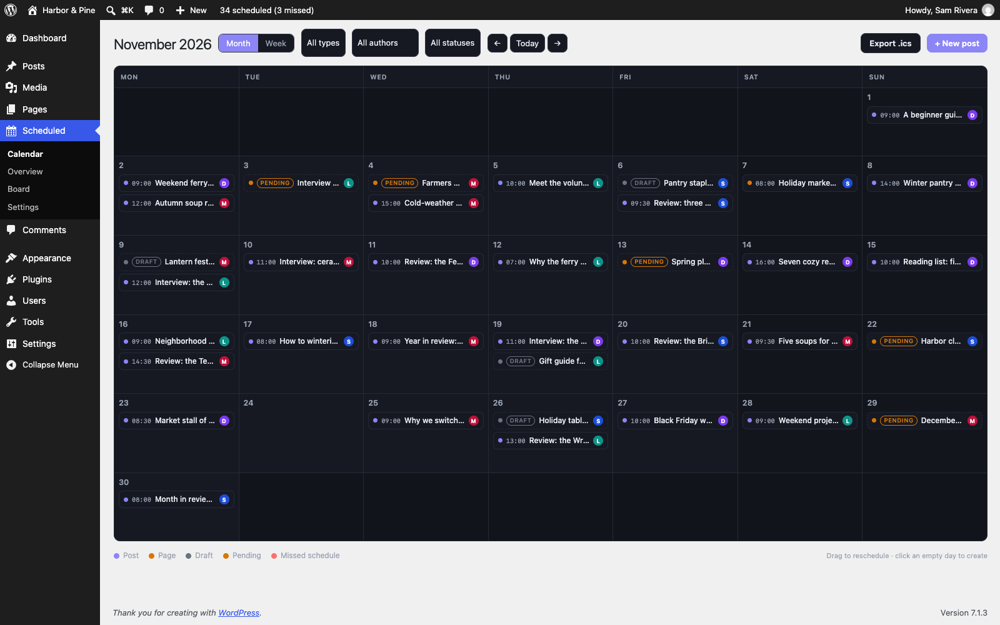

<h1 align="center">Scheduled Content Dashboard</h1>

<p align="center">Scheduled Content Dashboard | <a href="https://github.com/jgalea/scheduled-content-dashboard-pro">Scheduled Content Dashboard Pro</a></p>

<p align="center">
<a href="https://wordpress.org/plugins/scheduled-content-dashboard/"></a>
<a href="https://www.gnu.org/licenses/gpl-2.0.html"></a>
<a href="https://jeangalea.com/"></a>
</p>

<p align="center"><b>An editorial calendar, content overview and dashboard widget for scheduled WordPress content.</b></p>



## What it does

- Month and week calendar with drag-and-drop rescheduling, undo, multi-select and .ics export
- Click an empty day to create a post, or click a post to change its title and time
- Content Overview that groups everything in the pipeline by status, post type, author or category, with a past-due filter
- Dashboard widget grouped by Today, Tomorrow, This Week, Next Week and Later
- Flags posts WordPress failed to publish on time and republishes them when someone loads an admin page
- Admin bar counter, optional daily or weekly email digest, and REST endpoints

The free [Pro add-on](https://github.com/jgalea/scheduled-content-dashboard-pro) adds a drag-and-drop Content Board.

## Install

From WordPress: search for "Scheduled Content Dashboard" under Plugins > Add New.

From this repo: clone it into `wp-content/plugins/` and activate.

## Changing what's shown

New installs show Posts only. Pick other post types and the item limit under Scheduled > Settings, or filter the query:

```php
add_filter( 'scheduled_content_dashboard_query_args', function ( $args ) {
    $args['post_type'] = array( 'post', 'page' );
    return $args;
} );
```

## Requirements

- WordPress 5.3 or later
- PHP 7.4 or later
